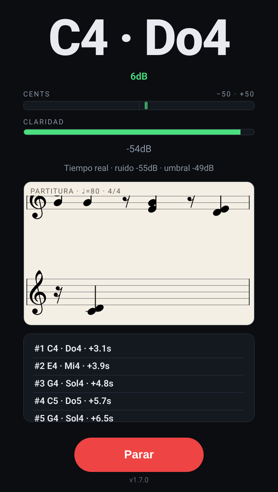

# 🎼 piano-transcribe

> Toca el piano y mira las notas en una partitura, en vivo. Micrófono, entrada de línea o MIDI.

**[▶ Probar ahora](https://juliangdeveloper.github.io/piano-transcribe/)** · gratis, en el navegador, sin instalar



## Cómo se usa

- Pulsa **Escuchar**. Con el micrófono, el navegador pide permiso.
- En ⚙ eliges micrófono, MIDI (USB o Bluetooth) o entrada de línea.
- Arriba ves la nota, los cents y la claridad.
- Cada compás va en clave de sol; en clave de fa si todas sus notas están bajo el do central (C4), o en pentagrama doble si mezcla ambas. ♩=80 y 4/4. Al pulsar **Parar** la partitura se queda. Al volver a escuchar, empieza de cero.
- En iPhone el permiso del micrófono se pide en cada carga. Si el audio queda suspendido, toca la pantalla.

La detección y la cuantización viven en el motor `engine/v1`. Esta página solo lo carga y dibuja el pentagrama con VexFlow.

```
python3 -m http.server 8000   # http://localhost:8000
npm test                       # Node, sin npm install
```

En local la página sigue pidiendo el motor publicado (el mismo URL de abajo). Los tests cubren el archivo del repo.

## Motor

Otros proyectos cargan el mismo módulo. La ruta mayor es `/engine/v1/`. Los cambios que no rompen el contrato se publican ahí y se toman en la siguiente carga. Un cambio incompatible irá a `/engine/v2/`.

Archivos:

| Archivo | Uso |
| --- | --- |
| `version.txt` | versión actual, una línea |
| `capture.js` | módulo ES, sin DOM ni VexFlow |

GitHub Pages envía `Access-Control-Allow-Origin: *` y `Content-Type: application/javascript`, así que el `import()` funciona desde otra página del mismo sitio y desde otro origen. En iPad e iPhone Safari basta con `import()` dinámico.

Cada carga pide `version.txt` sin caché y luego `capture.js?v=<versión>`. Así no se queda un motor viejo. Si no hay red, se reutiliza la última versión que sí cargó. La detección corre en el dispositivo: un hop cada `HOP_MS` (20 ms) con un frame de `AnalyserNode` (`fftSize` 2048). No hay ida y vuelta por nota.

Si el módulo no carga, hay que decirlo y seguir con teclado o MIDI si el proyecto los tiene.

### Cómo usarlo desde otro proyecto

```javascript
var ENGINE_ROOT = 'https://juliangdeveloper.github.io/piano-transcribe/engine/v1/';

function loadPianoEngine(root) {
  return fetch(root + 'version.txt?t=' + Date.now(), { cache: 'no-store' })
    .then(function (res) {
      if (!res.ok) throw new Error('version');
      return res.text();
    })
    .then(function (text) {
      var version = text.trim();
      try { localStorage.setItem('piano-transcribe.engine', version); } catch (e) {}
      return import(root + 'capture.js?v=' + encodeURIComponent(version));
    })
    .catch(function () {
      var version = '';
      try { version = localStorage.getItem('piano-transcribe.engine') || ''; } catch (e) {}
      return import(root + 'capture.js' + (version ? ('?v=' + encodeURIComponent(version)) : ''));
    })
    .then(function (mod) {
      if (!mod || mod.INTERFACE !== 1 || typeof mod.createCapture !== 'function') {
        throw new Error('interface');
      }
      return mod;
    });
}

loadPianoEngine(ENGINE_ROOT).then(function (engine) {
  // 'score': C2–C7, para escribir. 'combat': C3–C6, el mismo criterio del juego.
  var session = engine.createCapture({
    profile: 'score',
    maxVoices: 2,   // 1 es el default: una sola nota, igual que el perfil combat
    score: { bpm: 80, timeSig: '4/4', clef: 'treble' }
  });
  // Cada engine.HOP_MS, con el Float32 del AnalyserNode (fftSize 2048):
  var out = session.hop(frame, sampleRate, performance.now(), {
    blocked: [{ midi: 60, until: performance.now() + 200 }]
  });
  // out.events: { type:'on'|'off', pitch:'E3', note:'E', octave:3, midi, cents,
  //   source, sound, combat, fresh, released, t, voices }
  // voices: [{ pitch, note, octave, midi }, ...] notas que siguen sonando.
  // out.score.measures[].notes: { rest, pitch, note, octave, midi, midis, pitches,
  //   duration, beats, beat, measure, ottava, accidentals, voices }
  // pitch/note/octave/midi son la nota más grave. voices lista el acorde.
  // duration: w h q 8 16; el silencio lleva r (qr). MIDI < 48 trae ottava '8vb'.
  session.press('C4', 'key', performance.now());   // o session.press(60, 'midi', now)
  session.release('C4', 'key', performance.now());
  session.advance(performance.now());               // alarga lo que sigue pulsado
  session.releaseSource('mic');                     // suelta solo el micrófono
  session.reset();
  session.score();
  session.held();
}).catch(function () {
  // Mostrar el fallo. El teclado y el MIDI pueden seguir sin el motor.
});
```

`blocked` usa el mismo reloj que `now`. Mientras `now < until` no cuenta esa nota, el semitono vecino ni la octava (eco del altavoz).

`sound` es false en el micrófono para no reinyectar la nota por el speaker. `combat` es true solo la primera vez que esa nota se pulsa, aunque llegue por otra fuente.

`maxVoices` vale 1 si no se pasa. Con `2`, el micrófono puede sostener dos notas de piano a la vez (un bajo y una melodía, o un intervalo). Si la segunda no está clara, el motor se queda con una. Cada evento sigue trayendo su nota en `pitch` / `note` / `octave`; `voices` añade las que suenan juntas. En la partitura, `note` y `octave` son la más grave del acorde.

También exporta `noteFromFreq`, `noteFromMidi`, `hzForNote`, `detectPitch`, `sessionType`, `denyMessage` y `statusLine`. Las notas de una interpretación salen de `hop`, `press` y `release`; `detectPitch` solo mide un buffer.

## Relacionado

[piano-magic](https://github.com/juliangdeveloper/piano-magic) juega un combate con el piano y lee este motor. [Jugar](https://juliangdeveloper.github.io/piano-magic/)

---

Más proyectos: https://juliangdeveloper.github.io/

Hecho con ❤️ y 🎼
